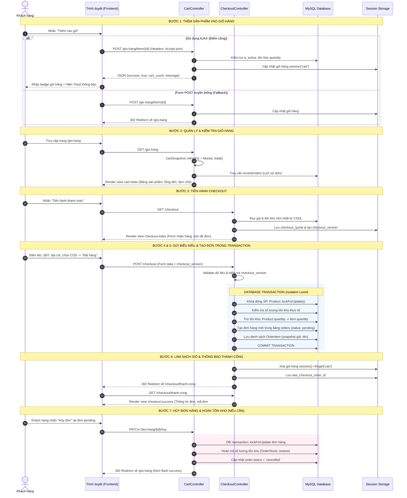

# Mô Tả Chi Tiết Luồng Đặt Hàng (Từ Giỏ Hàng → Tạo Đơn Hàng)

- **Học phần:** Lập trình mã nguồn mở
- **Dự án:** SneakerShop — Website kinh doanh giày thể thao
- **Thành viên phụ trách:** Phạm Minh Trọng
- **Nhiệm vụ phân công:** Giỏ hàng & Thanh toán (tạo đơn)
- **Điểm cộng kỹ thuật đã hoàn thành:** Tích hợp AJAX cho thao tác thêm vào giỏ hàng (không tải lại trang, cập nhật badge giỏ hàng thời gian thực, hiển thị thông báo Toast).

---

## 1. Thiết Kế Cơ Sở Dữ Liệu & Thực Thể Liên Quan

### 1.1. Bảng `orders` (Đơn hàng)

Bảng lưu trữ thông tin đơn hàng của khách hàng sau khi thanh toán:

| Tên cột | Kiểu dữ liệu | Ràng buộc | Ý nghĩa / Mục đích |
| :--- | :--- | :--- | :--- |
| `id` | `BIGINT UNSIGNED` | Primary Key, Auto Increment | Mã định danh đơn hàng |
| `user_id` | `BIGINT UNSIGNED` | Foreign Key (`users.id`) | Khách hàng sở hữu đơn hàng |
| `customer_name`| `VARCHAR(255)` | NOT NULL | Tên người nhận hàng |
| `phone` | `VARCHAR(20)` | NOT NULL | Số điện thoại liên hệ nhận hàng |
| `address` | `TEXT` | NOT NULL | Địa chỉ giao hàng chi tiết |
| `note` | `TEXT` | NULLABLE | Ghi chú đơn hàng của khách |
| `total_price` | `DECIMAL(15, 2)` | NOT NULL | Tổng giá trị đơn hàng |
| `payment_method`| `VARCHAR(50)` | NOT NULL, DEFAULT `'cod'` | Hình thức thanh toán (COD / Chuyển khoản) |
| `status` | `VARCHAR(50)` | NOT NULL, DEFAULT `'pending'` | Trạng thái: `pending`, `confirmed`, `shipping`, `completed`, `cancelled` |
| `checkout_token`| `VARCHAR(64)` | NULLABLE, UNIQUE | Token chống đặt trùng lặp đơn hàng |
| `created_at` | `TIMESTAMP` | NULLABLE | Thời gian tạo đơn |
| `updated_at` | `TIMESTAMP` | NULLABLE | Thời gian cập nhật đơn |

### 1.2. Bảng `order_items` (Chi tiết đơn hàng - Snapshot)

Lưu từng dòng sản phẩm thuộc về đơn hàng:

| Tên cột | Kiểu dữ liệu | Ràng buộc | Ý nghĩa / Mục đích |
| :--- | :--- | :--- | :--- |
| `id` | `BIGINT UNSIGNED` | Primary Key, Auto Increment | Mã chi tiết đơn |
| `order_id` | `BIGINT UNSIGNED` | Foreign Key (`orders.id`) | Khóa ngoại liên kết tới đơn hàng |
| `product_id` | `BIGINT UNSIGNED` | NULLABLE, FK (`products.id`) | Khóa ngoại sản phẩm (NULL nếu SP bị xóa) |
| `product_name` | `VARCHAR(255)` | NOT NULL | **Snapshot tên sản phẩm** tại thời điểm mua |
| `price` | `DECIMAL(15, 2)` | NOT NULL | **Snapshot đơn giá** tại thời điểm mua |
| `quantity` | `INT` | NOT NULL | Số lượng mua |
| `subtotal` | `DECIMAL(15, 2)` | NOT NULL | Thành tiền (`price * quantity`) |

> **Nguyên tắc thiết kế Snapshot bất biến:**  
> `order_items` lưu trữ trực tiếp `product_name` và `price` tại thời điểm thanh toán. Dù sau này quản trị viên thay đổi giá hoặc đổi tên sản phẩm trong bảng `products`, dữ liệu lịch sử hóa đơn của khách hàng vẫn giữ nguyên vẹn tính toàn vẹn tài chính.

---

## 2. Chi Tiết Toàn Bộ Luồng Nghiệp Vụ (7 Bước)



---

## 3. Mô Tả Chi Tiết Từng Giai Đoạn Kỹ Thuật

### Giai đoạn 1: Thêm sản phẩm vào giỏ hàng (`cart.add`)
* **Endpoint:** `POST /gio-hang/them/{id}`
* **Quyền truy cập:** Khách hàng đã đăng nhập (`auth`, `customer`).
* **Kiểm tra nghiệp vụ:**
  1. `CartSnapshot::productId($id)`: Chuẩn hóa ID để loại bỏ coercion hoặc alias route.
  2. Sản phẩm phải tồn tại và đang kinh doanh (`is_active = true`).
  3. Số lượng yêu cầu thêm phải dương và không vượt quá tồn kho thực tế của sản phẩm.
  4. Nếu sản phẩm đã có trong giỏ hàng, tổng số lượng mới (`currentQuantity + addedQuantity`) không được vượt quá số lượng tồn kho.
* **Cơ chế phản hồi đa phương thức (Progressive Enhancement):**
  * **Yêu cầu AJAX (Điểm cộng):** Trả về mã HTTP `200` cùng JSON:
    ```json
    {
      "success": true,
      "message": "Đã thêm Nike Air Force 1 vào giỏ hàng.",
      "cart_count": 3,
      "cart_total": "3.600.000",
      "product_name": "Nike Air Force 1"
    }
    ```
    Nếu vượt tồn kho, trả về mã HTTP `422` dạng JSON với thông báo lỗi rõ ràng.
  * **Yêu cầu Form POST truyền thống:** Trả về HTTP `302 Redirect` về `/gio-hang` kèm thông báo flash session. Giúp hệ thống tương thích 100% khi người dùng tắt JavaScript hoặc các bộ kiểm thử tự động cổ điển.

### Giai đoạn 2: Quản lý giỏ hàng (`cart.index`, `cart.update`, `cart.remove`)
* Giỏ hàng được lưu trữ an toàn trong Session dưới dạng mảng kết hợp có cấu trúc:
  ```php
  [
      $productId => [
          'id'        => 1,
          'name'      => 'Ulry Basta',
          'price'     => 450000.00,
          'image'     => 'products/sneaker1.jpg',
          'quantity'  => 2,
          'is_active' => true,
          'stock'     => 10,
      ]
  ]
  ```
* `CartSnapshot::refresh()` tự động đồng bộ lại giỏ hàng trước khi hiển thị: loại bỏ sản phẩm không tồn tại, cập nhật cờ hết hàng nếu sản phẩm bị vô hiệu hóa.
* Lớp hỗ trợ `Money::total($cart)` tính toán tổng tiền bằng số học số nguyên chính xác (tránh lỗi làm tròn số thực float trong thanh toán thương mại).
* Hiển thị bảng lịch sử 10 đơn hàng gần đây của khách kèm nút "Hủy đơn" đối với các đơn hàng còn ở trạng thái `pending`.

### Giai đoạn 3: Khởi tạo quy trình Checkout (`checkout.index`)
* Khách hàng bấm **Tiến hành thanh toán** chuyển sang trang `/checkout`.
* Hệ thống tiến hành khóa kiểm định giá và phiên (`checkout_version`):
  * Kiểm tra nếu giỏ hàng rỗng → chuyển hướng về `/san-pham`.
  * So sánh giá sản phẩm trong session với giá mới nhất trong database. Nếu có sự chênh lệch giá, cập nhật lại giỏ và thông báo cho khách hàng trước khi chốt đơn.
  * Sinh token phiên `checkout_version` để đảm bảo khách không gửi lại đơn cũ hoặc mở nhiều tab thanh toán gây sai lệch số lượng.

### Giai đoạn 4: Xác thực & Validation dữ liệu thanh toán (`checkout.store`)
Các trường dữ liệu được kiểm định nghiêm ngặt:
* `customer_name`: Bắt buộc, chuỗi văn bản, tối đa 255 ký tự.
* `phone`: Bắt buộc, chuỗi số điện thoại hợp lệ (chuẩn SQL 10-20 ký tự).
* `address`: Bắt buộc, tối đa 500 ký tự.
* `note`: Không bắt buộc, lọc bỏ mã độc HTML/Script khi render.
* `payment_method`: Bắt buộc, thuộc danh mục hợp lệ (`cod`).
* `checkout_version`: Bắt buộc khớp với quote hiện hành.

### Giai đoạn 5: Thực thi tạo đơn và trừ tồn kho trong Database Transaction
Để chống lỗi **Race Condition** (nhiều khách hàng cùng mua một sản phẩm sắp hết hàng):
1. Mở khối giao dịch `DB::transaction(function () { ... }, 3);` với 3 lần thử lại nếu gặp deadlock.
2. Áp dụng khóa độc quyền dòng `Product::whereIn('id', ...)->lockForUpdate()->get()`.
3. Kiểm tra số lượng tồn kho từng sản phẩm:
   * Nếu có bất kỳ sản phẩm nào không đủ tồn kho, ném `ValidationException` và tự động **Rollback** toàn bộ giao dịch, không trừ kho dở dang.
4. Trừ tồn kho sản phẩm: `Product::decrement('quantity', $itemQuantity)`.
5. Tạo bản ghi đơn hàng trong bảng `orders` với trạng thái ban đầu là `pending`.
6. Duyệt qua từng sản phẩm trong giỏ và tạo bản ghi `order_items` lưu lại tên, số lượng, đơn giá và thành tiền snapshot.

### Giai đoạn 6: Hoàn tất đơn hàng (`checkout.success`)
1. Làm sạch giỏ hàng trong session: `session()->forget('cart')` và `session()->forget('checkout_quote')`.
2. Ghi nhận mã đơn hàng vừa hoàn tất vào `session('last_checkout_order_id')`.
3. Điều hướng sang `/checkout/thanh-cong` hiển thị lời cảm ơn, mã đơn hàng, phương thức thanh toán và tổng tiền cần thanh toán khi nhận hàng (COD).

### Giai đoạn 7: Luồng hủy đơn hàng & hoàn trả kho (`cart.cancelOrder`)
* **Endpoint:** `PATCH /don-hang/{id}/huy`
* Khách hàng chỉ được phép hủy các đơn hàng có trạng thái `pending`.
* Giao dịch `DB::transaction` được kích hoạt:
  * Khóa dòng đơn hàng cần hủy (`lockForUpdate`).
  * Gọi `OrderStock::restore($order)`: duyệt qua từng `order_items` để cộng trả lại số lượng (`Product::increment('quantity', $itemQuantity)`) vào kho hàng.
  * Cập nhật trạng thái đơn thành `cancelled`.
  * Lưu giữ đơn trong database để bảo toàn lịch sử giao dịch và kế toán.

---

## 4. Điểm Cộng Kỹ Thuật: Tích Hợp AJAX Cho Thao Tác Thêm Vào Giỏ Hàng

### 4.1. Kiến trúc & Lợi ích
* **Trải nghiệm mượt mà:** Khách hàng bấm "Thêm vào giỏ" trên trang chủ hoặc trang danh mục không bị tải lại toàn bộ trang web (Zero Page Reload).
* **Cập nhật tức thì (Reactive Navbar):** Số lượng trên huy hiệu `badge` ở thanh menu tự động nhảy số kèm hiệu ứng rung nảy nhẹ (`badge-bump`).
* **Thông báo Toast hiện đại:** Sử dụng Bootstrap 5 Toast nổi ở góc phải bên dưới màn hình, hiển thị tên sản phẩm vừa thêm và nút tắt nhanh chuyển thẳng đến giỏ hàng.
* **Xử lý trạng thái nút:** Nút chuyển sang trạng thái *Spinner "Đang thêm..."* và tự động disable tạm thời để ngăn khách click liên tục nhiều lần (Debounce/Throttle).
* **Xử lý ngoại lệ chuẩn mực:**
  * Nếu chưa đăng nhập: Tự động điều hướng về màn hình `/login`.
  * Nếu vượt quá số lượng kho: Toast chuyển sang màu đỏ báo lỗi cụ thể.
  * Nếu mất kết nối mạng: Tự động fallback submit form theo cách truyền thống.

### 4.2. Mã nguồn triển khai tiêu biểu

**Tại `CartController.php`:**
```php
if ($request->expectsJson() || $request->ajax()) {
    $totalCount = array_sum(array_column($cart, 'quantity'));
    return response()->json([
        'success'      => true,
        'message'      => 'Đã thêm ' . $product->name . ' vào giỏ hàng.',
        'cart_count'   => $totalCount,
        'cart_total'   => Money::format(Money::total($cart)),
        'product_name' => $product->name,
    ]);
}
```

**Tại `layouts/app.blade.php`:**
```javascript
const response = await fetch(form.action, {
    method: 'POST',
    body: new FormData(form),
    headers: {
        'X-Requested-With': 'XMLHttpRequest',
        'Accept': 'application/json'
    }
});
const data = await response.json();
if (response.ok && data.success) {
    cartBadge.textContent = data.cart_count;
    cartBadge.classList.add('badge-bump');
    toast.show();
}
```

---

## 5. Kết Quả Kiểm Thử (Verification & Testing)

Hệ thống đã bổ sung bộ kiểm thử tính năng `Tests\Feature\CartAjaxTest` với 5 ca kiểm thử chuyên sâu:
1. `test_ajax_add_to_cart_success_returns_json`: Kiểm thử thêm sản phẩm qua AJAX trả về đúng JSON, cập nhật session và cấu trúc dữ liệu.
2. `test_ajax_add_to_cart_accumulates_quantity`: Kiểm thử cộng dồn số lượng khi thêm nhiều lần qua AJAX.
3. `test_ajax_add_to_cart_exceeds_stock_returns_422`: Kiểm thử vượt tồn kho trả về mã lỗi HTTP 422 JSON.
4. `test_ajax_add_to_cart_requires_authentication`: Kiểm thử chặn khách chưa đăng nhập (HTTP 401).
5. `test_standard_form_post_still_redirects_for_backward_compatibility`: Kiểm thử tương thích ngược với form POST truyền thống (HTTP 302).

* **Tổng số ca kiểm thử toàn dự án:** **138 tests / 3.003 assertions ĐẠT 100% (0 lỗi, 0 cảnh báo)**.
