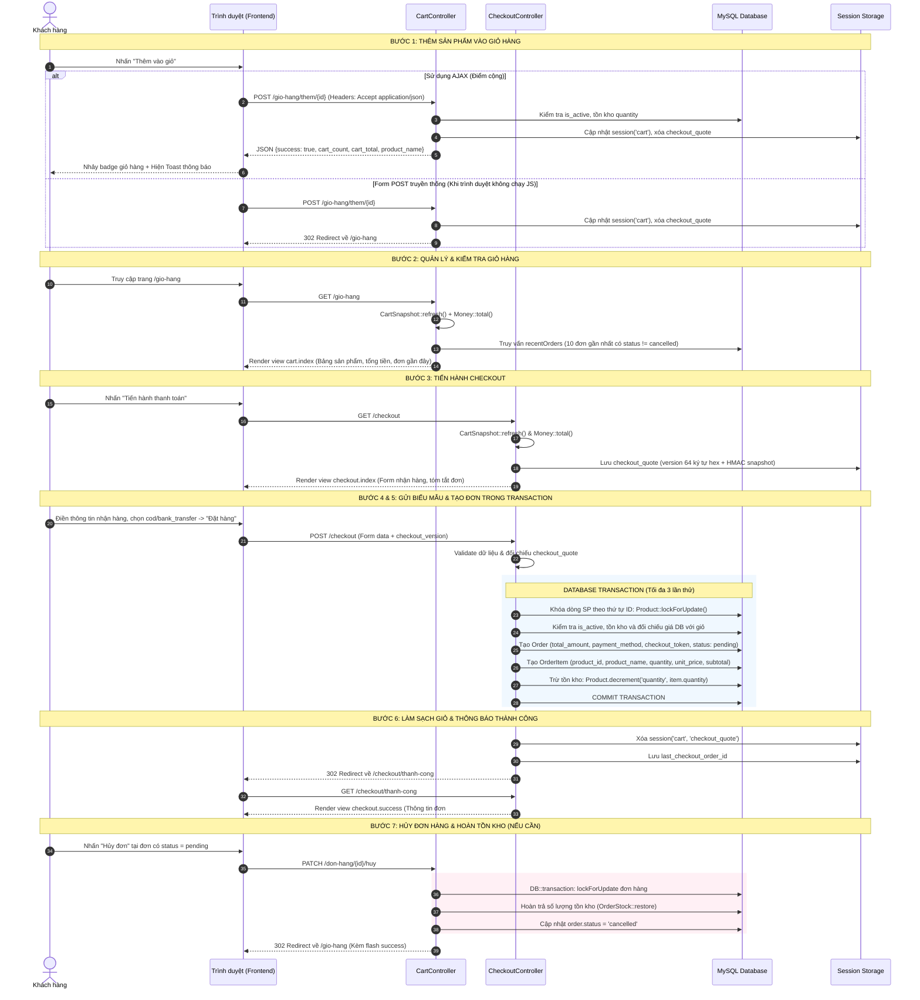

# Mô Tả Chi Tiết Luồng Đặt Hàng (Từ Giỏ Hàng → Tạo Đơn Hàng)

- **Học phần:** Lập trình mã nguồn mở
- **Dự án:** SneakerShop — Website kinh doanh giày thể thao
- **Thành viên phụ trách:** Phạm Minh Trọng
- **Nhiệm vụ phân công:** Giỏ hàng & Thanh toán (tạo đơn)
- **Điểm cộng kỹ thuật đã hoàn thành:** Tích hợp AJAX cho thao tác thêm vào giỏ hàng (không tải lại trang, cập nhật badge giỏ hàng thời gian thực, hiển thị thông báo Toast).

---

## 1. Thiết Kế Cơ Sở Dữ Liệu & Thực Thể Liên Quan

### 1.1. Bảng `orders` (Đơn hàng)

Bảng lưu trữ thông tin đơn hàng của khách hàng sau khi đặt hàng:

| Tên cột | Kiểu dữ liệu | Ràng buộc | Ý nghĩa / Mục đích |
| :--- | :--- | :--- | :--- |
| `id` | `BIGINT UNSIGNED` | Primary Key, Auto Increment | Mã định danh đơn hàng |
| `user_id` | `BIGINT UNSIGNED` | NULLABLE, FK (`users.id`), `ON DELETE SET NULL` | Khách hàng sở hữu đơn hàng |
| `customer_name` | `VARCHAR(255)` | NOT NULL | Tên người nhận hàng |
| `phone` | `VARCHAR(20)` | NOT NULL | Số điện thoại liên hệ nhận hàng |
| `address` | `TEXT` | NOT NULL | Địa chỉ giao hàng chi tiết |
| `note` | `TEXT` | NULLABLE | Ghi chú đơn hàng của khách |
| `total_amount` | `DECIMAL(15, 2)` | NOT NULL, DEFAULT `0` | Tổng giá trị đơn hàng |
| `status` | `VARCHAR(255)` | NOT NULL, DEFAULT `'pending'` | Trạng thái đơn: `pending`, `processing`, `completed`, `cancelled` |
| `payment_method` | `VARCHAR(30)` | NOT NULL, DEFAULT `'cod'` | Phương thức thanh toán: `cod`, `bank_transfer` |
| `checkout_token` | `VARCHAR(64)` | NULLABLE, UNIQUE | Token idempotency chống tạo đơn trùng lặp |
| `created_at` | `TIMESTAMP` | NULLABLE | Thời gian tạo đơn |
| `updated_at` | `TIMESTAMP` | NULLABLE | Thời gian cập nhật đơn |

### 1.2. Bảng `order_items` (Chi tiết đơn hàng - Snapshot)

Lưu từng dòng sản phẩm thuộc về đơn hàng:

| Tên cột | Kiểu dữ liệu | Ràng buộc | Ý nghĩa / Mục đích |
| :--- | :--- | :--- | :--- |
| `id` | `BIGINT UNSIGNED` | Primary Key, Auto Increment | Mã chi tiết đơn |
| `order_id` | `BIGINT UNSIGNED` | NOT NULL, FK (`orders.id`), `ON DELETE CASCADE` | Khóa ngoại liên kết tới đơn hàng |
| `product_id` | `BIGINT UNSIGNED` | NULLABLE, FK (`products.id`), `ON DELETE SET NULL` | Khóa ngoại sản phẩm (`NULL` nếu sản phẩm bị xóa) |
| `product_name` | `VARCHAR(255)` | NOT NULL | **Snapshot tên sản phẩm** tại thời điểm đặt |
| `quantity` | `INT UNSIGNED` | NOT NULL | Số lượng mua |
| `unit_price` | `DECIMAL(15, 2)` | NOT NULL | **Snapshot đơn giá** tại thời điểm đặt |
| `subtotal` | `DECIMAL(15, 2)` | NOT NULL | Thành tiền dòng (`unit_price * quantity`) |
| `created_at` | `TIMESTAMP` | NULLABLE | Thời gian tạo bản ghi |
| `updated_at` | `TIMESTAMP` | NULLABLE | Thời gian cập nhật bản ghi |

> **Nguyên tắc thiết kế Snapshot bất biến:**  
> `order_items` lưu trữ trực tiếp `product_name` và `unit_price` tại thời điểm đặt hàng. Dù sau này quản trị viên thay đổi giá, đổi tên hoặc xóa sản phẩm trong bảng `products` (`product_id` về `NULL`), dữ liệu lịch sử đơn hàng của khách vẫn giữ nguyên vẹn.

---

## 2. Chi Tiết Toàn Bộ Luồng Nghiệp Vụ (7 Bước)



---

## 3. Mô Tả Chi Tiết Từng Giai Đoạn Kỹ Thuật

### Giai đoạn 1: Thêm sản phẩm vào giỏ hàng (`CartController@add`)
* **Endpoint:** `POST /gio-hang/them/{id}`
* **Middleware:** `auth`, `customer`.
* **Kiểm tra nghiệp vụ:**
  1. `CartSnapshot::productId($id)`: Chuẩn hóa ID nguyên dương hợp lệ, từ chối chuỗi sai định dạng (404).
  2. Validate `quantity`: số nguyên từ `1` đến `2147483647` (mặc định là `1`).
  3. Sản phẩm phải tồn tại và đang mở bán (`is_active = true`).
  4. Kiểm tra số lượng thêm mới và tổng số lượng cộng dồn trong giỏ (`$currentQuantity + $quantity`) không vượt quá tồn kho `$product->quantity`.
  5. Kiểm tra tổng giá trị giỏ hàng qua `Money::total($cart)` trước khi lưu vào `session('cart')` và xóa `session('checkout_quote')`.
* **Cơ chế phản hồi:**
  * **Yêu cầu AJAX (`$request->expectsJson() || $request->ajax()`):** Trả về HTTP `200` dạng JSON:
    ```json
    {
      "success": true,
      "message": "Đã thêm Nike Air Force 1 vào giỏ hàng.",
      "cart_count": 2,
      "cart_total": "2.400.000",
      "product_name": "Nike Air Force 1"
    }
    ```
    Nếu vượt tồn kho, trả về HTTP `422` dạng JSON kèm thông báo lỗi.
  * **Yêu cầu Form POST thông thường:** Trả về HTTP `302 Redirect` về `/gio-hang` kèm flash message `success`.

### Giai đoạn 2: Quản lý giỏ hàng (`CartController@index`, `update`, `remove`)
* Mỗi mục trong `session('cart')` lưu cấu trúc:
  ```php
  [
      $productId => [
          'id'        => $product->id,
          'name'      => $product->name,
          'price'     => $product->price,
          'image'     => $product->image,
          'quantity'  => $quantity,
          'is_active' => (bool) $product->is_active,
          'stock'     => (int) $product->quantity,
      ]
  ]
  ```
* `CartSnapshot::refresh()` tự động chuẩn hóa giỏ hàng (gộp mục trùng khóa số học, loại mục không hợp lệ) và đồng bộ lại tên, giá, trạng thái bán, tồn kho mới nhất từ bảng `products`.
* `Money::total($cart)` tính tổng tiền theo đơn vị xu nguyên (`cents`) để tránh sai số số thực dấu phẩy động.
* Truy vấn tối đa 10 đơn hàng gần nhất của khách có `status != 'cancelled'` để hiển thị tại trang giỏ hàng.

### Giai đoạn 3: Khởi tạo quy trình Checkout (`CheckoutController@index`)
* **Endpoint:** `GET /checkout`
* Làm mới giỏ hàng qua `CartSnapshot::refresh()`. Nếu giỏ hàng trống (`empty($cart)`), chuyển hướng về `route('cart.index')` (`/gio-hang`) kèm thông báo lỗi `'Giỏ hàng của bạn đang trống.'`.
* Tính tổng tiền `$total = Money::total($cart)`.
* Sinh mã phiên `$checkoutVersion = bin2hex(random_bytes(32))` (64 ký tự hex) và chữ ký HMAC-SHA256 `CartSnapshot::version($cart)`, lưu vào `session('checkout_quote')` để bảo vệ form thanh toán khỏi tình trạng mở nhiều tab hoặc dữ liệu giỏ hàng bị thay đổi trước khi bấm đặt.

### Giai đoạn 4: Xác thực & Validation biểu mẫu thanh toán (`CheckoutController@store`)
* **Endpoint:** `POST /checkout`
* **Quy tắc Validation:**
  * `customer_name`: `required|string|max:255`
  * `phone`: `required|string|max:20`, khớp biểu thức chính quy `/^\+?[0-9][0-9 .()\-]{7,18}[0-9]$/D` và chứa từ 9 đến 15 chữ số.
  * `checkout_version`: `required|string|size:64`
  * `address`: `required|string|max:1000`
  * `note`: `nullable|string|max:2000`
  * `payment_method`: `required|in:cod,bank_transfer`
* Kiểm tra giỏ hàng đã chuẩn hóa và đối chiếu `hash_equals` giữa `checkout_version` gửi lên với `session('checkout_quote')` (cả `version` và `snapshot`).

### Giai đoạn 5: Thực thi tạo đơn và trừ tồn kho trong Database Transaction
1. Sắp xếp các khóa sản phẩm trong giỏ tăng dần (`ksort($cart, SORT_NUMERIC)`) để luôn khóa các dòng `products` theo cùng một thứ tự, ngăn chặn Deadlock khi nhiều giao dịch diễn ra đồng thời.
2. Kiểm tra Idempotency thông qua `checkout_token`: nếu đơn hàng với `checkout_token` của user hiện tại đã được tạo trước đó, trả về ngay đơn hàng đó mà không tạo đơn mới.
3. Mở giao dịch `DB::transaction(..., 3)`:
   * Với từng sản phẩm trong giỏ, gọi `Product::where('is_active', true)->whereKey($id)->lockForUpdate()->first()`.
   * Kiểm tra sản phẩm còn tồn tại/đang bán, số lượng đặt `<= $product->quantity`, và giá trong DB khớp với giá lúc báo giá (`Money::cents($product->price) === Money::cents($item['price'])`).
   * Cộng dồn `$subtotal = Money::line($product->price, $quantity)` và kiểm tra không vượt `Money::MAX_CENTS`.
   * Tạo bản ghi `Order` với `total_amount => Money::decimal($total)`, `payment_method`, `checkout_token`, và `status => 'pending'`.
   * Tạo các bản ghi `OrderItem` (`product_id`, `product_name`, `quantity`, `unit_price`, `subtotal`) và trừ tồn kho `$product->decrement('quantity', $item['quantity'])`.

### Giai đoạn 6: Hoàn tất đơn hàng (`CheckoutController@success`)
1. Xóa giỏ hàng và báo giá khỏi session: `session()->forget(['cart', 'checkout_quote'])` sau khi transaction đã commit thành công.
2. Lưu `session()->put('last_checkout_order_id', $order->id)`.
3. Điều hướng sang `GET /checkout/thanh-cong` (`checkout.success`) hiển thị thông tin đơn hàng thuộc đúng `user_id` đang đăng nhập.

### Giai đoạn 7: Quản lý trạng thái đơn, Hủy đơn & Hoàn trả tồn kho
* **Các trạng thái đơn hàng hợp lệ:** `pending` (Chờ xử lý), `processing` (Đang xử lý), `completed` (Đã hoàn thành), `cancelled` (Đã hủy).
* **Khách hàng hủy đơn (`CartController@cancelOrder` - `PATCH /don-hang/{id}/huy`):**
  * Chỉ được hủy đơn thuộc về chính mình và đang ở trạng thái `pending` (nếu khác `pending` trả về mã lỗi `422`).
  * Thực thi trong `DB::transaction(..., 3)`: khóa đơn hàng `lockForUpdate()`, gọi `OrderStock::restore($order)` để khóa các dòng sản phẩm theo thứ tự `product_id` và cộng trả lại `quantity` vào bảng `products`, sau đó đổi `order->status = 'cancelled'`.
* **Quản trị viên cập nhật trạng thái (`Admin\OrderController@updateStatus` - `PATCH /admin/orders/{order}/status`):**
  * Chỉ cho phép chuyển trạng thái theo luồng:
    * `pending` → `processing` hoặc `cancelled`
    * `processing` → `completed` hoặc `cancelled`
    * Đơn đã ở `completed` hoặc `cancelled` không thể thay đổi trạng thái tiếp.
  * Khi chuyển sang `cancelled`, hệ thống gọi `OrderStock::restore($lockedOrder)` đúng một lần trong transaction.

---

## 4. Điểm Cộng Kỹ Thuật: Tích Hợp AJAX Cho Thao Tác Thêm Vào Giỏ Hàng

### 4.1. Cơ chế hoạt động
* **Không tải lại trang:** Khi khách hàng nhấn "Thêm vào giỏ" tại trang chủ (`/`) hoặc trang sản phẩm (`/san-pham`), sự kiện `submit` được xử lý qua `fetch()` bất đồng bộ với header `X-Requested-With: XMLHttpRequest` và `Accept: application/json`.
* **Cập nhật số lượng trên Navbar:** Huy hiệu `#navCartBadge` tự động cập nhật theo `data.cart_count` kèm hiệu ứng `badge-bump`.
* **Hiển thị Toast thông báo:** Hiển thị Bootstrap 5 Toast góc dưới bên phải màn hình báo thành công (màu xanh) hoặc báo lỗi vượt tồn kho/dữ liệu không hợp lệ (màu đỏ).
* **Xử lý khi chưa đăng nhập:** Nếu nhận mã HTTP `401`, trình duyệt tự động chuyển hướng người dùng đến trang `/login`.
* **An toàn khi lỗi mạng (`catch`):** Khi kết nối mạng bị gián đoạn, trình duyệt hiển thị thông báo lỗi cho người dùng để kiểm tra lại giỏ hàng, **không tự động gọi `form.submit()` lại** nhằm tránh nguy cơ gửi lặp yêu cầu làm nhân đôi số lượng sản phẩm nếu request trước đã được máy chủ xử lý.

### 4.2. Đoạn mã xử lý chính

**Tại `app/Http/Controllers/CartController.php`:**
```php
$total = Money::total($cart);
session()->put('cart', $cart);
session()->forget('checkout_quote');

if ($request->expectsJson() || $request->ajax()) {
    $totalCount = array_sum(array_column($cart, 'quantity'));
    return response()->json([
        'success' => true,
        'message' => 'Đã thêm ' . $product->name . ' vào giỏ hàng.',
        'cart_count' => $totalCount,
        'cart_total' => Money::format($total),
        'product_name' => $product->name,
    ]);
}
```

---

## 5. Kết Quả Kiểm Thử (Verification & Testing)

1. **Kiểm thử tự động (`Tests\Feature\CartAjaxTest` & toàn bộ test suite):**
   * `test_ajax_add_to_cart_success_returns_json`: Thêm giỏ qua AJAX trả về HTTP 200 JSON, cập nhật đúng `cart_count`, `cart_total`, `product_name`.
   * `test_ajax_add_to_cart_accumulates_quantity`: Cộng dồn số lượng chính xác qua nhiều lần gọi AJAX.
   * `test_ajax_add_to_cart_exceeds_stock_returns_422`: Vượt tồn kho trả về HTTP 422 JSON kèm thông báo lỗi.
   * `test_ajax_add_to_cart_requires_authentication`: Khách chưa đăng nhập nhận HTTP 401.
   * `test_standard_form_post_still_redirects_for_backward_compatibility`: Gửi form POST thông thường vẫn redirect 302 về `/gio-hang`.
   * **Tổng kết PHPUnit:** **138 tests / 3.003 assertions ĐẠT 100%**.
2. **Kiểm thử thực tế trên trình duyệt (Browser End-to-End):**
   * Đã kiểm chứng đầy đủ 4 kịch bản thực tế trên Chrome:
     1. Chưa đăng nhập bấm thêm vào giỏ → tự động chuyển hướng sang `/login`.
     2. Đăng nhập khách hàng bấm thêm vào giỏ hợp lệ → không tải lại trang, `#navCartBadge` tăng số lượng, Toast xanh hiển thị thông báo thành công.
     3. Nhập số lượng hoặc cộng dồn vượt tồn kho → giữ nguyên số lượng cũ trên navbar, Toast đỏ hiển thị lỗi vượt tồn kho.
     4. Lỗi mạng khi gửi AJAX → hiển thị Toast đỏ báo lỗi kết nối, không tự động submit lại form (không nhân đôi sản phẩm trong giỏ).
